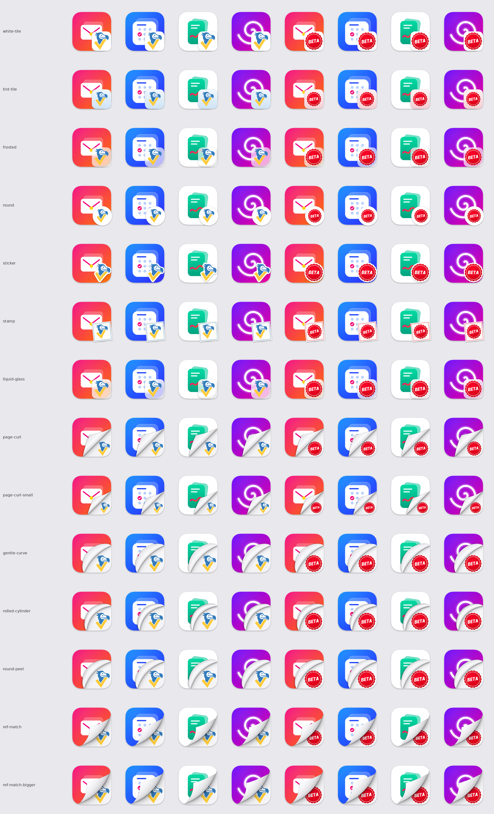
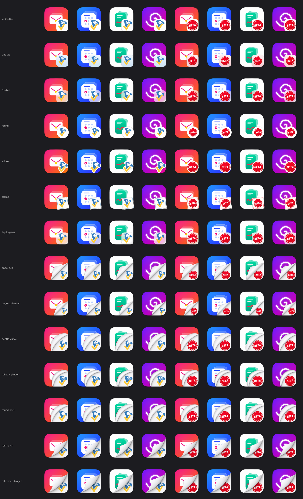
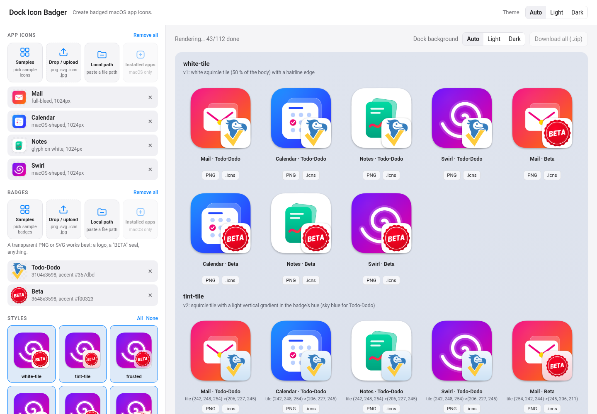

# Dock Icon Badger

Create badged macOS app icons. The badge can be anything: a logo, a "BETA" seal, a dev/staging marker. Every app icon gets the badge image in its bottom-right corner, in one of 14 styles, from simple tiles and stickers to a realistic page curl that reveals the badge under the app's lifted corner. Output follows the macOS Big Sur+ icon grid (824 px continuous-corner squircle on a 1024 canvas, Apple's drop shadow), so icons look native in the Dock and avoid the gray tile macOS 26 puts behind non-conforming icons.

Any number of app icons × any number of badge images × any number of styles. Nothing is tied to one logo: badge size and placement come from the badge's own shape, and colors from its dominant color.

## Styles

| Light | Dark |
| --- | --- |
|  |  |

| Style | Look |
| --- | --- |
| `white-tile` | White squircle tile (v1) |
| `tint-tile` | Tile with a light gradient in the badge's hue (v2, sky blue for Todo-Dodo) |
| `frosted` | Frosted glass tile over the blurred app art |
| `liquid-glass` | Tahoe-style glass with specular highlight and rim |
| `round` | White circle hanging past the corner |
| `sticker` | Die-cut sticker traced around the badge's shape, rotated |
| `stamp` | Perforated postage stamp, frame in the badge's color |
| `page-curl`, `page-curl-small` | Corner folded back along a straight crease, badge underneath (v3) |
| `gentle-curve`, `rolled-cylinder`, `round-peel` | Curved fold rolling back over the art (v4) |
| `ref-match` (default) | Realistic curled corner matched to a reference image (v5, the approved look) |
| `ref-match-bigger` | `ref-match` with a bigger curl |

## Web UI

A local web app with everything the CLI does. App icons and badges each have four sources: **Samples** (a picker with All / None / Recommended; Recommended is preselected while the list is empty, None once it has items, and samples already added show as "added"), **Drop / upload**, **Local path**, and **Installed apps** (macOS). A glowing, pulsing background points at the next thing to fill in. Items already in a list are never added twice. All styles start selected; tweak each style's knobs (rotation is a slider for `sticker` and `stamp`). There is no Render button: every change re-renders live, and only the icons it affects. Rotation is in degrees, positive = clockwise. Preview every app × badge × style on a light or dark Dock background (the page theme and the Dock background each have Auto / Light / Dark; Auto follows your system setting) and download PNGs, `.icns` files or one zip.

```bash
python3 run.py            # add --open to launch the browser, --port 9000 to pick a port
```

The first run creates `.venv` and installs `requirements.txt`; later runs start right away. It prints one line with the address, e.g. `Dock Icon Badger running at http://127.0.0.1:8765` (the next free port is used if 8765 is busy). Stop it with Ctrl+C. Needs only `python3` 3.8+ on macOS or Linux. SVG files need the cairo library (`brew install cairo` / `sudo apt install libcairo2`) or librsvg; without them the UI says so and PNG/.icns inputs still work.



**Ask your AI assistant to run it.** Paste this into any AI coding assistant that can run commands on your computer:

> Clone https://github.com/dluxhu/dock-icon-badger, run `python3 run.py` in it, and give me the link it prints. Keep it running until I say I'm done, then stop it.

Agents: see [`AGENTS.md`](AGENTS.md).

The server listens on 127.0.0.1 only, rejects other `Host` headers, limits uploads to 25 MB per file, reads local paths read-only (icon file types only), and deletes its temporary files when it stops.

## Command line

### Quick start (macOS)

```bash
python3 -m venv .venv && source .venv/bin/activate
pip install -r requirements.txt
brew install cairo            # only needed for .svg inputs (cairosvg)

# One app, one badge, default style (ref-match)
python3 dock_icon_badger.py --app /Applications/YourApp.app --logo samples/badges/todo-dodo.svg --out out/

# Every icon in a folder, two badges, three styles, plus a preview sheet
python3 dock_icon_badger.py --apps-dir samples/apps --logo samples/badges/todo-dodo.svg --logo samples/badges/beta.png \
    --style sticker --style stamp,round --out out/ --preview

# Everything
python3 dock_icon_badger.py --apps-dir samples/apps --logo samples/badges/beta.svg --style all --out out/ --preview
```

Each app × badge × style produces a 1024×1024 PNG and an `.icns` with all 10 iconset sizes.

- **One style:** files go straight into `--out`, e.g. `out/Mail.png`.
- **Several styles:** one subfolder per style, e.g. `out/sticker/Mail.png`.
- **Several badges:** files are named `<App> - <Badge>.png/.icns`.

### Inputs

- **Apps** (`--app`, repeatable, or `--apps-dir`): `.icns`, `.png`, `.svg`, `.iconset` folders, or `.app` bundles. Full-bleed squares, ready-made macOS squircles and bare glyphs are detected and normalized automatically.
- **Badges** (`--logo`, repeatable): `.svg`, `.png` or `.icns`. Trimmed to their visible pixels; an opaque white background is removed.

### Options

| Option | What it does |
| --- | --- |
| `--style NAME` | Style to render; repeat it, comma-separate, or use `all`. Default `ref-match`. |
| `--size ref\|bigger\|<factor>` | Badge/curl size. `bigger` is ref-match's bigger preset; a number scales any style. |
| `--overlap 0.12` | ref-match: fraction of the badge hidden under the curl. |
| `--rotate DEG` | Rotation for the styles that rotate (`sticker`, `stamp`): positive = clockwise, negative = counter-clockwise; same as `--param rotate=DEG`. Defaults: sticker 9, stamp −6. |
| `--accent '#rrggbb'` | Color for every `auto` color knob (default: the badge's dominant color). |
| `--param [style.]key=value` | Override any style knob, e.g. `--param stamp.rotate=-4`, `--param fill=0.8`. |
| `--list-styles` | Print every style with its knobs and defaults. |
| `--no-icns` | PNGs only. |
| `--icns-backend iconutil\|builtin\|icnsutil` | Force an `.icns` writer (default: `iconutil` on macOS). |
| `--preview`, `--preview-split` | Light/dark contact sheet (`preview.png`), or separate `preview-light.png` / `preview-dark.png`. |

## Installing an icon

Open the app's **Get Info** in Finder and drag the `.icns` (or PNG) onto the icon in the top-left, or use [`fileicon`](https://github.com/mklement0/fileicon): `fileicon set /Applications/YourApp.app "out/YourApp.icns"`. Restart the Dock with `killall Dock` if it doesn't refresh.

## Repository layout

| Path | What it is |
| --- | --- |
| `dock_icon_badger.py` | The generator (all styles): CLI and importable library (`App`, `Logo`, `render`, `styles_metadata`). |
| `run.py` | One-command start for the web UI (creates `.venv`, installs requirements, starts the server). |
| `server.py` | The web UI server (standard library only, 127.0.0.1). |
| `web/` | The single-page UI (`index.html`, no build step) and style thumbnails. |
| `AGENTS.md` | How AI agents should run the web UI for a user. |
| `dock-icon-badger.md` | Skill doc: exact geometry of every style, research, tuning, troubleshooting, and the full script. |
| `samples/` | Original sample app icons (Mail, Calendar, Notes, Swirl, Weather, Terminal, Music, Chat) and badges (Todo-Dodo, Beta, Dev), made by `samples/make_samples.py`. Used by the UI's sample pickers and the gallery. |
| Other folders | Development history (earlier inputs and outputs); not needed to use the tool. |
| `examples/` | Style gallery and web UI screenshot; `examples/make_gallery.py` regenerates the gallery and the UI thumbnails from `samples/`. |

## More detail

[`dock-icon-badger.md`](dock-icon-badger.md) is the full spec: per-style geometry and knobs, the exact ref-match curl, Apple icon template research, tuning tips, troubleshooting, and a copy of the script so the doc stands on its own.

## License

[MIT](LICENSE) © 2026 Balazs Szabo. This covers the code and the original artwork in `samples/`, `examples/` and `web/`. The Todo-Dodo logo (`samples/badges/todo-dodo.*`, also shown in the examples) belongs to Todo-Dodo, is included with permission as a sample badge, and is not covered by the MIT license.
