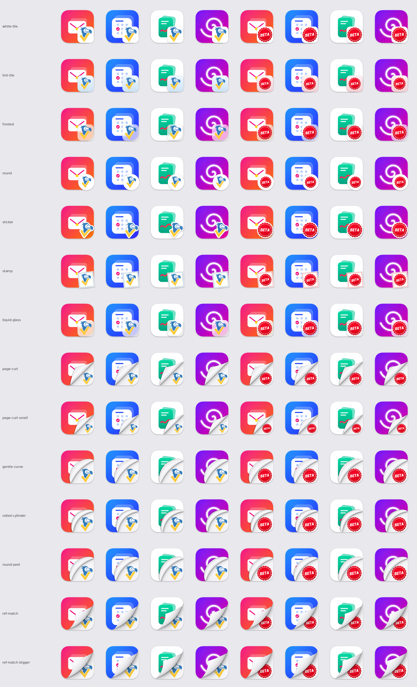

# Skill: Dock Icon Badger — create badged macOS app icons, in 14 styles

**When to use:** you want to add a badge to macOS app icons (a logo, a "BETA" mark, a dev/staging marker, anything): every app icon gets the badge image in its bottom-right corner. The script takes any number of app icons and any number of badge images and renders every app × badge × style combination.

**Output per icon:** a 1024×1024 PNG and an `.icns` with all 10 iconset sizes (16, 32, 128, 256, 512 at 1x and @2x). Optionally a light/dark preview sheet with 64 px and 32 px strips.

Everything needed to reproduce the looks is in this file. The full script is at the bottom; save it as `dock_icon_badger.py`.

**Web UI:** `python3 run.py` starts a local web app (127.0.0.1) with the same features: add icons and badges from samples, uploads, local paths or installed apps, pick styles (all selected by default) and knobs (rotation sliders for sticker and stamp; knob changes re-render only that style, live), everything re-renders automatically; preview and download PNG/.icns/zip. It prints `Dock Icon Badger running at http://127.0.0.1:<port>`. See README.md ("Web UI") and AGENTS.md. The UI uses `dock_icon_badger.py` as a library (`App`, `Logo`, `render`, `styles_metadata`); `server.py`, `run.py` and `web/index.html` aren't embedded here.



---

## 1. Shared rules (every style)

All numbers are on the 1024 px canvas.

- **macOS icon grid (Big Sur and later).** Transparent 1024×1024 canvas. The visible body is Apple's 824×824 continuous-corner squircle, centered with 100 px margins, drawn from the exact vector path of Apple's icon template (corner radius about 185.4). Drop shadow from the template: black at 30 % opacity, Gaussian σ = 12, 10 px down. Sources: <https://developer.apple.com/forums/thread/761179>, <https://gist.github.com/frypf/80d7a2d1690821f6061b2b2c1a5d9553>.
- **App art normalization.** Each source is classified automatically:
  - **Full-bleed square** (opaque, e.g. the Mail sample): scaled into the squircle.
  - **Already a macOS squircle** (e.g. the Calendar and Swirl samples): kept. If its body isn't on the 824 grid, it's refit to it.
  - **Free-form glyph with no background** (e.g. the Notes sample): placed at 66 % width on a white squircle. This avoids the gray tile macOS 26 Tahoe puts behind non-conforming icons ("squircle jail").
  - Small sources are Lanczos-upscaled; the script prints a note.
- **Badge size and anchor.** The badge is 50 % of the body (412 px) and aligns to the body's bottom-right corner at (924, 924). Some styles hang a few px past it on purpose (`overhang`). `--size` scales every style's badge (or curl) by a factor.
- **Badge image handling (generic, nothing is specific to one logo).**
  - The badge is trimmed to its alpha bounding box. An opaque badge on a white square has the white keyed out.
  - It is fitted by its **longest side** (`fill` × badge size), so tall, wide and square badges all fit; then centered on its bounding box.
  - `holes=white` fills transparent holes enclosed by the logo (e.g. the dodo's face) with white; `holes=keep` leaves them see-through.
  - **Accent color:** the badge's dominant saturated color (opaque pixels quantized to 32 levels; largest bin, averaged). Neutral badges use their mean color. Any color knob set to `auto` uses it (stamp frame, tint-tile gradient). Todo-Dodo → (53, 125, 189). Override with `--accent '#rrggbb'`.
  - The curl styles search for the largest badge that fits the revealed paper, so the badge shape decides its size there.

## 2. The styles

Run `python3 dock_icon_badger.py --list-styles` for every knob with its default. Override any knob with `--param key=value` (applies to every selected style that has it) or `--param style.key=value`. Colors are `auto`, `#rrggbb` or `r,g,b`; shadows are `opacity,sigma,dx,dy`; px values scale with `--size`.

### Badge-on-top styles

| Style | Look | Geometry and defaults | Knobs |
|---|---|---|---|
| `white-tile` (v1) | White squircle tile with the logo | 412 px squircle tile at (512, 512); logo `fill` 0.90; hairline edge ring 10 % (5 px); shadow 35 % σ9 +6 down | `tile`, `fill`, `holes`, `ring`, `shadow`, `nudge_x/y` |
| `tint-tile` (v2) | Tile with a light vertical gradient in the badge's hue (sky blue for Todo-Dodo) | Gradient top = HSV(accent hue, s 0.047, v 0.996), bottom = HSV(hue, s 0.159, v 0.961); saturation is scaled down for grayish accents. Logo `fill` 0.74, `holes=keep`; ring 12 % | `top`, `bottom` (`auto` or a color), `top_sat/val`, `bottom_sat/val`, `fill`, `holes`, `ring`, `shadow` |
| `frosted` | Frosted glass tile | App art under the tile blurred (σ 22), 66 % white veil, logo `fill` 0.86; shadow 25 % σ10 +6 | `blur`, `veil`, `veil_opacity`, `fill`, `holes`, `ring`, `shadow` |
| `liquid-glass` | Tahoe-like glass | Blur σ 28, 72 % white veil, top specular gradient (55 % fading out at 45 % height), bright top rim and dark bottom rim; logo `fill` 0.86; shadow 30 % σ12 +8 | `blur`, `veil`, `veil_opacity`, `specular`, `fill`, `holes`, `ring`, `shadow` |
| `round` | White circle | 412 px circle shifted 18 px past the corner; logo `fill` 0.70 (a square logo's diagonal still fits) | `tile`, `overhang`, `fill`, `holes`, `ring`, `shadow` |
| `sticker` | Die-cut sticker | White backing traced around the logo's own alpha (dilate by `border` 18 px, smooth, threshold), thin edge, rotated by `rotate` (9° clockwise by default; positive = clockwise, negative = counter-clockwise; any angle works). The logo is scaled so the rotated sticker's **alpha bounding box** is `size` × 412 px (1.024), whatever the badge shape, and that box's bottom-right sits at the corner + (`overhang_x` 6, `overhang_y` −7) | `size`, `border`, `rotate`, `backing`, `overhang_x/y`, `holes`, `shadow` |
| `stamp` | Postage stamp | 412 px cream paper (#fffdf8), perforation holes radius 11 every ~30 px, inner frame 4 px at 26 px inset in the accent color, logo `fill` 0.74, rotated by `rotate` (−6°, i.e. 6° counter-clockwise, by default), 34 px overhang. Beyond ±6° the stamp shrinks so its rotated footprint stays the size of the 6° stamp (412 px at 0–6°, 320 px at 45°) | `paper`, `frame`, `frame_inset`, `frame_width` (0 = none), `perf_radius`, `perf_step`, `rotate`, `overhang`, `fill`, `holes`, `ring`, `shadow` |

### Page-curl styles (the badge is under the app art)

The app art is the "page"; its bottom-right corner lifts and the badge sits on white paper underneath (paper gray 250 → 244 top to bottom, holes always filled white). The logo is the largest that fits the revealed area (eroded 27 px), pushed toward the corner and shifted down by `logo_drop` × its height (0.04).

| Style | Look | Geometry |
|---|---|---|
| `page-curl` (v3) | Corner folded back along a straight 45° crease | Fold `length` 600 px from the corner along each edge. The flap is the fold triangle reflected over the crease and pulled toward it by `flap` 0.52; its two edges bow outward by `bow` 0.06 × length. Flap shaded 196 at the crease → 252 → 222 at the tip; crease shadow 32 % over 38 px; flap drop shadow 45 % σ14 (−6, +8). |
| `page-curl-small` | Same, smaller | `length` 500, `flap` 0.42. |
| `gentle-curve` (v4-A) | Curved fold, page gently rolls back over the art | Fold depth `length` 485 px on the diagonal, bowing away from the corner by `bend` 0.16 (parabolic in the cross direction). A roll `roll_width` 0.36 × length wide lies over the art, tapering to the ends (`tip_round` 1.0), with cylindrical shading `gentle`. Roll shadow 42 % σ15 (−7, +7). |
| `rolled-cylinder` (v4-B) | Tight cylinder | `length` 500, `bend` 0.26, `roll_width` 0.26, shading `roll` (dark-light-dark), `tip_round` 0.7. |
| `round-peel` (v4-C) | Rounder peel | `length` 505, `bend` 0.20, `roll_width` 0.31, shading `peel`, `tip_round` 0.85. |
| `ref-match` (v5, **default**, approved) | Realistic curled corner from the reference image | Exact spec in section 3. Knobs: `length` 700, `flap` 0.78, `overlap` 0.08–0.16 (`--overlap`), `logo_drop`. |
| `ref-match-bigger` | Bigger curl | `length` 760, `flap` 0.84 (same as `--style ref-match --size bigger`). |

Shading profiles for the v4 rolls are in `SHADING` in the script (gray levels from the fold to the roll's outer edge).

## 3. ref-match: exact geometry

Visual reference: realistic curled paper corner, <https://img.magnific.com/free-vector/realistic-curled-paper-corner_134830-683.jpg>

All numbers below are on the 1024 px canvas.

1. **macOS icon grid (Big Sur and later).** The canvas is 1024×1024 and transparent. The visible body is Apple's 824×824 continuous-corner squircle, centered with 100 px margins. The script draws the exact vector path from Apple's icon template (corner radius about 185.4).
   - Drop shadow from Apple's template: black at 30 % opacity, Gaussian σ = 12, offset 10 px down.
   - Sources:
     - <https://developer.apple.com/forums/thread/761179>
     - <https://gist.github.com/frypf/80d7a2d1690821f6061b2b2c1a5d9553>
2. **App art normalization.** The script classifies each source automatically:
   - **Full-bleed square** (opaque, e.g. the Mail sample): scaled into the squircle.
   - **Already a macOS squircle** (e.g. the Calendar and Swirl samples): kept as is. If its body isn't on the 824 grid, it's refit to it.
   - **Free-form glyph with no background** (e.g. the Notes sample): placed at 66 % width on a white squircle. This avoids the gray tile that macOS 26 Tahoe puts behind non-conforming icons ("squircle jail").
   - Small sources are upscaled with Lanczos, and the script prints a note when that happens.
3. **The page edge.** The app art is the "page". Its remaining edge is a circular arc that starts on the right edge and ends on the bottom edge, each L = 700 px from the corner (measured along the 824 body edge). It bows toward the corner: at the diagonal it sits 0.522·L ≈ 365 px from the corner. Seen from the page, the arc is concave and sweeps from the top-right down to the bottom-left, as in the reference.
4. **The curled flap.** The back of the curled corner is drawn as a white teardrop lying on top of the app art:
   - It's wide and rounded where it joins the arc at both ends, and tapers to a pointed tip aimed up-left, slightly off the diagonal like the reference.
   - It's built from the arc plus two quadratic Bézier edges. Control points come from the reference image, scaled by k = 0.78.
   - Shading: gray in the crease along the fold (gray value 192), brightening to about 253 toward the outer edge and tip, and slightly grayer toward the top-right end.
   - It also has a faint drop shadow on the art (30 %, σ 7) and a thin outline.
5. **Revealed paper.** Behind the curl is white paper with a subtle top-to-bottom gradient (gray 251 to 246). The curl casts a soft shadow onto it that follows the arc: a 42 % wide falloff over 55 px plus an 18 % tight falloff over 12 px, strongest mid-arc and fading toward the ends.
6. **Side image (logo).** The logo goes on the paper as large as fits, about 342 px tall for ref-match.
   - It's tucked under the curl so 8–16 % of its pixels are hidden at the top-left (ref-match: 16 %).
   - Transparent holes enclosed inside the logo (e.g. the dodo's face) are filled white so the logo reads cleanly.
   - An opaque logo on a white square has its white background removed automatically.


## 4. Setup (macOS)

```bash
cd ~/Src/"Mac Docker Icons"            # this repo's checkout
python3 -m venv .venv
source .venv/bin/activate
pip install -r requirements.txt          # pillow, numpy, cairosvg (cairosvg only for .svg inputs)
brew install cairo                        # cairosvg needs the cairo library
```

If you'd rather not install cairo, `brew install librsvg` works instead: the script will use `rsvg-convert`. Failing both, it falls back to Quick Look (`qlmanage`), which renders on white and gets keyed out, so the edges are less clean. Or pass PNG logos. On macOS, `.icns` files are written with Apple's `iconutil`, with no extra dependency.

## 5. Usage

```bash
# Default style (ref-match), one app, one badge
python3 dock_icon_badger.py --app samples/apps/Mail.png --logo samples/badges/todo-dodo.svg --out out/

# Pick styles: repeat --style, comma-separate, or use 'all'
python3 dock_icon_badger.py --apps-dir samples/apps --logo todo-dodo.svg --style sticker --style stamp,round --out out/ --preview
python3 dock_icon_badger.py --apps-dir samples/apps --logo todo-dodo.svg --style all --out out/ --preview

# Several badges: every app x badge pair, named "<App> - <Badge>.png/.icns"
python3 dock_icon_badger.py --apps-dir samples/apps --logo todo-dodo.svg --logo beta.png --style stamp --out out/

# Straight from installed apps (reads Contents/Resources/<CFBundleIconFile>.icns)
python3 dock_icon_badger.py --app /Applications/Slack.app --app "/Applications/Google Chrome.app" --logo todo-dodo.svg --out out/

# Tuning
python3 dock_icon_badger.py ... --size bigger                 # ref-match: L=760, k=0.84; other styles: x1.086
python3 dock_icon_badger.py ... --size 0.9                    # every style's badge/curl 10 % smaller
python3 dock_icon_badger.py ... --overlap 0.05                # ref-match: hide ~5 % of the logo (window ±4 %)
python3 dock_icon_badger.py ... --accent '#e4572e'            # color for every 'auto' knob
python3 dock_icon_badger.py ... --style sticker,stamp --rotate 20      # both rotate 20 degrees clockwise (negative = counter-clockwise)
python3 dock_icon_badger.py ... --style stamp --param frame='#222222' --param rotate=-4
python3 dock_icon_badger.py ... --style all --param sticker.rotate=8 --param fill=0.8
python3 dock_icon_badger.py ... --no-icns --preview-split     # PNGs only; also preview-light/dark.png
python3 dock_icon_badger.py --list-styles                     # every style, knob and default
```

**Output layout:**
- One style: files go straight into `--out` (`out/Mail.png`, `out/Mail.icns`).
- Several styles: one subfolder per style (`out/sticker/Mail.png`, `out/stamp/Mail.png`, …).
- Several badges: file names get the badge name, `<App> - <Badge>` (badge name = file name without extension).
- `--preview` writes `out/preview.png`: one row per style × badge, light half and dark half, with 64 px and 32 px strips. `--preview-split` also writes `preview-light.png` and `preview-dark.png`.

**Notes:**
- With `--apps-dir`, a badge file that sits in the same folder is skipped, so it isn't treated as an app.
- An app named "Foo" can be `Foo.icns`, `Foo.png`, `Foo.svg`, `Foo.iconset/` (largest PNG) or `Foo.app`.
- Run time: tile styles about 0.5 s per icon, curl styles 4–8 s (numpy at full resolution).

## 6. Tuning constants

Per-style knobs are in `STYLES` (section 2, `--list-styles`). Global constants at the top of the script:

| Constant | Effect |
|---|---|
| `B`, `CORNER` | Badge size (50 % of the body) and its anchor (924, 924). |
| `APPLE_SHADOW`, `GLYPH_FILL`, `GRID_TOL` | Apple template shadow; size of background-less glyphs; on-grid tolerance. |
| `CURL_PRESETS` | ref-match `(L, k)` for `--size ref` / `bigger`. |
| `ARC_MID`, `FLAP_TIP`, `FLAP_CTRL_UPPER`, `FLAP_CTRL_LOWER`, `FLAP_BASE` | ref-match page edge and teardrop flap shape, from the reference. |
| `FLAP_SHADE_T/V`, `FLAP_SHADE_TOPRIGHT`, `CURL_SHADOW`, `CURL_SHADOW_ENDS`, `FLAP_DROP`, `FLAP_EDGE` | ref-match shading and shadows. |
| `OVERLAP`, `LOGO_MAX`, `LOGO_BODY_MARGIN` | ref-match: how much of the logo hides under the curl; largest logo size; distance from the rounded corner. |
| `PAPER_TOP/PAPER_FALL` | ref-match revealed paper brightness and gradient. |
| `SHADING` | v4 roll shading profiles (`gentle`, `roll`, `peel`). |

## 7. Putting the icon on an app

- **Finder:** select the app, press ⌘I, then drag the `.icns` (or the PNG) onto the small icon at the top-left of the Info window. Alternatively, open the PNG in Preview, ⌘A ⌘C, click that small icon and press ⌘V. Then restart the app or the Dock (`killall Dock`).
- **CLI:** `brew install fileicon`, then run `fileicon set "/Applications/Slack.app" "out/Slack.icns"`.
- **No-install one-liner (JXA / NSWorkspace):**
  ```bash
  osascript -l JavaScript -e 'ObjC.import("AppKit"); $.NSWorkspace.sharedWorkspace.setIconForFileOptions($.NSImage.alloc.initWithContentsOfFile("/full/path/out/Slack.icns"), "/Applications/Slack.app", 0)' && killall Dock
  ```

**Caveats:**
- App Store apps may ask for an admin password. Apple's own system apps (SIP-protected) can't be changed.
- An app update can reset the icon. Re-run the step afterwards, or use a tool like Replacicon.
- **macOS 26 Tahoe:** non-conforming bundled icons get shrunk onto a gray squircle ("squircle jail"). Custom icons set this way are shown as is, and these outputs already fill the 824 squircle, so they look native. Custom icons don't follow Tahoe's Clear, Tinted or Dark icon modes.

## 8. Troubleshooting

- **`Cannot render SVG`:** run `pip install cairosvg` and `brew install cairo`, or `brew install librsvg`. You can also export the logo to a large PNG (e.g. 2048 px) and pass that instead.
- **`OSError: no library called "cairo"`** on macOS with Apple Silicon: run `export DYLD_FALLBACK_LIBRARY_PATH=/opt/homebrew/lib`, or use librsvg instead.
- **Logo shows as a white square:** the PNG's background isn't pure white (the key-out threshold is 242). Use a transparent PNG or the SVG.
- **An icon is misclassified** (check the printed `kind`): squircle detection uses opaque pixels (alpha > 250). Icons with a translucent body may be treated as glyphs. Supply a full-bleed PNG of the artwork instead.
- **`No .icns found in X.app`:** the icon lives only in `Assets.car`. Select the app in Finder, press ⌘I, click the icon, ⌘C, then in Preview use File ▸ New from Clipboard and save it as PNG. Use that PNG with `--app`.
- **`badge does not fit under the curl`:** use a bigger `--size`, or a wider `--overlap` window (ref-match). Very wide or square badges get small under the curl styles; a tile, round, sticker or stamp style suits them better.
- **Not on macOS:** `.icns` is written by a small built-in writer (10 PNG-based entries). Use `--icns-backend icnsutil` (`pip install icnsutil`) if you prefer that tool.

## 9. Verification done

- Every style was checked against the hand-tuned versions it was distilled from (curl styles match to a mean per-pixel difference below 0.1 of 255, apart from a 1–2 px anti-aliasing band on the squircle outline).
- Genericity: every style was rendered with badges of very different shapes and colors (tall and blue, wide and multicolor, opaque square and neutral, round and red). Stickers trace each shape, stamps and tints pick up each badge's color, curls size each badge to the paper.
- `.icns` output via the built-in writer and `icnsutil` was checked: every file has 10 entries (16–512 @1x/@2x). Multi-style subfolders, multi-badge naming and `--preview` were tested on Linux. The macOS `iconutil`, `qlmanage` and `sips` paths were written carefully but not run here.

---

## 10. The script: `dock_icon_badger.py`

```python
#!/usr/bin/env python3
"""
dock_icon_badger.py - macOS Dock icons with a badge image (a logo, a "BETA" mark, ...) in the
bottom-right corner, in one of several styles: tiles, glass, round, sticker, stamp, or a
page curl that reveals the badge under the app's curled corner.

Each app icon is normalized onto Apple's macOS icon grid (1024 canvas, 824x824
continuous-corner squircle, Apple template drop shadow). The badge takes 50 % of the body
(412 px) and sits on the body's bottom-right corner (924, 924). Every style works for any
number of app icons x any number of badge images: badge size, placement and colors are
derived from the badge image (alpha bounding box, dominant color) and every knob can be
overridden with --param.

Deps: Pillow, numpy. SVG inputs also need one of: cairosvg (pip), rsvg-convert, inkscape,
or macOS qlmanage. On macOS, .icns files are written with `iconutil`. Elsewhere the script
uses a built-in writer, or `icnsutil` (pip) on request.

Usage: python3 dock_icon_badger.py --app YourApp.icns --logo logo.svg --out out/ [--style all] [--preview]
       python3 dock_icon_badger.py --list-styles
"""
import argparse, colorsys, glob, io, math, os, plistlib, re, shutil, subprocess, sys, tempfile
import numpy as np
from PIL import Image, ImageChops, ImageDraw, ImageFilter, ImageFont

# ============================== TUNABLE CONSTANTS ==============================
# --- macOS icon grid (Big Sur+ template, 1024 canvas) ---
S = 1024                  # canvas size
BODY = 824                # visible squircle body (Apple: 824x824, 100 px margins)
M = (S - BODY) // 2       # margin = 100
B = BODY // 2             # badge size: 50 % of the body = 412 px
CORNER = M + BODY         # body's bottom-right corner (924, 924): badges align to it
APPLE_SHADOW = (0.30, 12, 0, 10)   # (opacity, gaussian sigma, dx, dy): Apple template shadow
GLYPH_FILL = 0.66         # free-form glyphs (no background) are placed on white at 66% of body
GRID_TOL = 16             # px tolerance to treat an alpha icon as "already on the 824 grid"
LOGO_RENDER = 4096        # render resolution for SVG badges

# --- ref-match curl geometry (derived from the reference image, scaled by L) ---
# L: length (px, along the body's right/bottom edge) of the corner region that is curled.
# The page edge is a circular arc through the two edge points (L from the corner) and a mid point
# ARC_MID * L from the corner (measured along the diagonal) - it bows toward the corner.
CURL_PRESETS = {           # --size name: (L, FLAP_K) for ref-match
    "ref":    (700, 0.78), # "ref-match" - the approved look
    "bigger": (760, 0.84), # same as the ref-match-bigger style
}
ARC_MID = 0.522           # arc depth at the diagonal, as a fraction of L (from the reference)
# Flap (teardrop) control points in (diagonal distance, cross distance) units of L, from the ref:
FLAP_TIP = (0.974, -0.068)       # pointed tip (up-left, slightly off-diagonal like the ref)
FLAP_CTRL_UPPER = (0.821, 0.175) # quadratic control, upper edge (tip -> top-right end)
FLAP_CTRL_LOWER = (0.703, -0.282)# quadratic control, lower/left edge (bottom-left end -> tip)
FLAP_BASE = (0.57, -0.59)        # where the flap meets the arc (cross position / L), each end
PAPER_TOP, PAPER_FALL = 251, 5    # revealed paper brightness, and darkening toward the bottom
CURL_SHADOW = (0.42, 55, 0.18, 12)  # cast shadow on paper: wide (opacity, falloff px) + tight
CURL_SHADOW_ENDS = 0.35           # shadow strength at the arc ends relative to the middle
FLAP_SHADE_T = [0, 0.06, 0.25, 0.6, 1]          # position from crease (0) to tip (1)
FLAP_SHADE_V = [192, 222, 240, 250, 253]        # gray levels at those positions
FLAP_SHADE_TOPRIGHT = 32          # extra crease gray toward the top-right end (like the ref)
FLAP_DROP = (0.30, 7, -3, 5)      # faint shadow of the flap on the app art
FLAP_EDGE = (0.12, 3)             # thin outline on the flap (opacity, width)
OVERLAP = (0.08, 0.16)    # ref-match: fraction of logo pixels hidden under the curl (min, max)
LOGO_MAX = 0.62           # ref-match: start search at logo height = 0.62 * L, shrink in 4 px steps
LOGO_BODY_MARGIN = 41     # ref-match: erosion (px) keeping the logo off the rounded corner
# Per-style knobs live in STYLES (bottom of the style section); see --list-styles.
# ===============================================================================

SQUIRCLE_D = "m 924,355.412 c 0,-9.782 0,-18.35 -0.056,-28.133 -0.049,-8.241 -0.144,-16.48 -0.368,-24.716 -0.484,-17.954 -1.543,-36.061 -4.736,-53.813 -3.238,-18.01 -8.526,-34.77 -16.859,-51.133 a 171.963,171.963 0 0 0 -31.661,-43.559 172.06,172.06 0 0 0 -43.574,-31.64 c -16.381,-8.335 -33.159,-13.621 -51.188,-16.858 -17.755,-3.188 -35.867,-4.245 -53.82,-4.73 -8.243,-0.223 -16.485,-0.317 -24.73,-0.368 -9.788,-0.06 -19.576,-0.055 -29.364,-0.055 L 553.997,100 h -84.999 l -111.637,0.407 c -9.807,0 -19.614,-0.005 -29.421,0.055 -8.262,0.051 -16.52,0.145 -24.778,0.368 -17.995,0.485 -36.148,1.543 -53.945,4.735 -18.053,3.236 -34.857,8.52 -51.259,16.849 a 172.405,172.405 0 0 0 -43.667,31.644 171.994,171.994 0 0 0 -31.718,43.551 c -8.356,16.372 -13.654,33.143 -16.9,51.162 -3.196,17.746 -4.255,35.846 -4.742,53.792 -0.222,8.237 -0.318,16.476 -0.368,24.716 -0.06,9.784 -0.563,21.937 -0.563,31.72 v 195.999 l 0.508,112.429 c 0,9.796 -0.004,19.592 0.055,29.388 0.05,8.252 0.146,16.502 0.369,24.751 0.486,17.976 1.547,36.109 4.746,53.886 3.245,18.032 8.542,34.818 16.891,51.201 a 172.24,172.24 0 0 0 31.722,43.619 172.444,172.444 0 0 0 43.659,31.684 c 16.412,8.346 33.224,13.639 51.288,16.88 17.789,3.193 35.936,4.252 53.924,4.737 8.258,0.223 16.517,0.318 24.779,0.368 9.807,0.059 19.613,0.059 29.42,0.059 h 310.283 c 9.788,0 19.576,0 29.364,-0.059 8.245,-0.05 16.487,-0.145 24.73,-0.368 17.96,-0.486 36.078,-1.546 53.841,-4.741 18.018,-3.241 34.788,-8.532 51.159,-16.873 a 172.004,172.004 0 0 0 43.582,-31.687 172.23,172.23 0 0 0 31.659,-43.612 c 8.337,-16.391 13.625,-33.184 16.865,-51.229 3.19,-17.77 4.248,-35.896 4.733,-53.865 0.223,-8.25 0.318,-16.5 0.367,-24.751 C 924,687.019 924,677.223 924,667.427 Z"   # Apple macOS icon squircle (path in 100..924 coordinates)
LZ = Image.LANCZOS

# ---------------------------------------------------------------- squircle raster
def _svg_path_polys(d, steps=24):
    toks = re.findall(r"[A-Za-z]|[-+]?(?:\d+\.?\d*|\.\d+)(?:[eE][-+]?\d+)?", d)
    i = 0; cmd = None; x = y = sx = sy = 0.0; polys = []; cur = []
    def num():
        nonlocal i; v = float(toks[i]); i += 1; return v
    while i < len(toks):
        if re.match(r"[A-Za-z]", toks[i]): cmd = toks[i]; i += 1
        rel = cmd.islower(); c = cmd.lower()
        if c == "z":
            if cur: polys.append(cur); cur = []
            x, y = sx, sy; continue
        if c == "m":
            dx, dy = num(), num(); x, y = (x + dx, y + dy) if rel else (dx, dy)
            sx, sy = x, y; cur = [(x, y)]; cmd = "l" if rel else "L"; continue
        if c == "l":
            dx, dy = num(), num(); x, y = (x + dx, y + dy) if rel else (dx, dy); cur.append((x, y))
        elif c == "h":
            v = num(); x = x + v if rel else v; cur.append((x, y))
        elif c == "v":
            v = num(); y = y + v if rel else v; cur.append((x, y))
        elif c == "c":
            p = [num() for _ in range(6)]
            if rel: p = [p[0]+x, p[1]+y, p[2]+x, p[3]+y, p[4]+x, p[5]+y]
            for t in np.linspace(0, 1, steps)[1:]:
                mt = 1 - t
                cur.append((mt**3*x + 3*mt*mt*t*p[0] + 3*mt*t*t*p[2] + t**3*p[4],
                            mt**3*y + 3*mt*mt*t*p[1] + 3*mt*t*t*p[3] + t**3*p[5]))
            x, y = p[4], p[5]
        elif c == "a":
            rx, ry, phi, fa, fs, ex, ey = [num() for _ in range(7)]
            if rel: ex, ey = ex + x, ey + y
            cur.extend(_arc(x, y, rx, ry, math.radians(phi), int(fa), int(fs), ex, ey, steps))
            x, y = ex, ey
        else:
            raise ValueError("unsupported path command " + cmd)
    if cur: polys.append(cur)
    return polys

def _arc(x1, y1, rx, ry, phi, fa, fs, x2, y2, steps):
    cp, sp = math.cos(phi), math.sin(phi)
    dx, dy = (x1 - x2) / 2, (y1 - y2) / 2
    x1p, y1p = cp*dx + sp*dy, -sp*dx + cp*dy
    lam = x1p**2/rx**2 + y1p**2/ry**2
    if lam > 1: rx, ry = rx*math.sqrt(lam), ry*math.sqrt(lam)
    num_ = rx*rx*ry*ry - rx*rx*y1p*y1p - ry*ry*x1p*x1p
    co = math.sqrt(max(0, num_ / (rx*rx*y1p*y1p + ry*ry*x1p*x1p))) * (-1 if fa == fs else 1)
    cxp, cyp = co*rx*y1p/ry, -co*ry*x1p/rx
    cx, cy = cp*cxp - sp*cyp + (x1 + x2)/2, sp*cxp + cp*cyp + (y1 + y2)/2
    ang = lambda ux, uy, vx, vy: math.atan2(ux*vy - uy*vx, ux*vx + uy*vy)
    t1 = ang(1, 0, (x1p - cxp)/rx, (y1p - cyp)/ry)
    dt = ang((x1p - cxp)/rx, (y1p - cyp)/ry, (-x1p - cxp)/rx, (-y1p - cyp)/ry)
    if not fs and dt > 0: dt -= 2*math.pi
    if fs and dt < 0: dt += 2*math.pi
    out = []
    for t in np.linspace(0, 1, steps)[1:]:
        a = t1 + dt*t
        out.append((cx + rx*math.cos(a)*cp - ry*math.sin(a)*sp, cy + rx*math.cos(a)*sp + ry*math.sin(a)*cp))
    return out

_POLYS = None
def squircle_mask(size, off=0):
    """Alpha mask of Apple's squircle. off = margin (in 1024-grid px) around the 824 body."""
    global _POLYS
    if _POLYS is None: _POLYS = _svg_path_polys(SQUIRCLE_D)
    ss = 8; sc = size * ss / (BODY + 2*off); o = 100 - off
    m = Image.new("L", (size*ss, size*ss), 0); d = ImageDraw.Draw(m)
    for p in _POLYS: d.polygon([((px - o)*sc, (py - o)*sc) for px, py in p], fill=255)
    return m.resize((size, size), Image.BOX)   # box filter = exact area coverage (matches cairo AA)

# ---------------------------------------------------------------- small helpers
def shadow(a, op, sigma, dx=0, dy=0):
    sh = Image.new("RGBA", a.size, (0, 0, 0, 0)); sh.putalpha(a.point(lambda v: int(v*op)))
    sh = sh.filter(ImageFilter.GaussianBlur(sigma))
    o = Image.new("RGBA", a.size, (0, 0, 0, 0)); o.alpha_composite(sh, (dx, dy)); return o

def edge_ring(mask, op, w=5):
    e = ImageChops.subtract(mask, mask.filter(ImageFilter.MinFilter(w)))
    r = Image.new("RGBA", mask.size, (0, 0, 0, 0)); r.putalpha(e.point(lambda v: int(v*op))); return r

def ss_(e): return np.clip(e + 0.5, 0, 1)

def bez(p0, p1, p2, n=80):
    return [((1-t)**2*p0[0] + 2*(1-t)*t*p1[0] + t*t*p2[0], (1-t)**2*p0[1] + 2*(1-t)*t*p1[1] + t*t*p2[1])
            for t in np.linspace(0, 1, n)]

def which(*names):
    for n in names:
        if shutil.which(n): return n
    return None

# ---------------------------------------------------------------- loading images
def render_svg(path, size):
    try:
        import cairosvg
        return Image.open(io.BytesIO(cairosvg.svg2png(url=path, output_width=size, output_height=size))).convert("RGBA")
    except Exception:
        pass
    tmp = tempfile.mkdtemp()
    out = os.path.join(tmp, "r.png")
    if which("rsvg-convert"):
        subprocess.run(["rsvg-convert", "-w", str(size), "-h", str(size), "-o", out, path], check=True)
    elif which("inkscape"):
        subprocess.run(["inkscape", path, "--export-type=png", f"--export-filename={out}", f"--export-width={size}"], check=True)
    elif which("qlmanage"):   # macOS Quick Look; renders on white -> white background keyed out
        subprocess.run(["qlmanage", "-t", "-s", str(size), "-o", tmp, path], check=True, capture_output=True)
        out = glob.glob(os.path.join(tmp, "*.png"))[0]
        return key_out_white(Image.open(out).convert("RGBA"))
    else:
        sys.exit(f"Cannot render SVG {path}: pip install cairosvg (macOS: brew install cairo), or install librsvg.")
    return Image.open(out).convert("RGBA")

def open_icns(path):
    """Open the largest representation of an .icns (handles old and new Pillow APIs)."""
    im = Image.open(path)
    sizes = im.info.get("sizes")
    if sizes:
        w, h, scale = max(sizes, key=lambda s: s[0]*s[2])
        try:
            im.size = (w, h); im.load(scale=scale)          # Pillow >= 10
        except Exception:
            im = Image.open(path)
            try: im.size = (w, h, scale)                     # older Pillow
            except Exception: pass
            im.load()
    return im.convert("RGBA")

def app_bundle_icon(app):
    res = os.path.join(app, "Contents", "Resources")
    try:
        with open(os.path.join(app, "Contents", "Info.plist"), "rb") as f: info = plistlib.load(f)
        name = info.get("CFBundleIconFile")
        if name:
            p = os.path.join(res, name if name.endswith(".icns") else name + ".icns")
            if os.path.exists(p): return p
    except Exception:
        pass
    for cand in ["AppIcon.icns"] + sorted(glob.glob(os.path.join(res, "*.icns"))):
        p = cand if os.path.isabs(cand) else os.path.join(res, cand)
        if os.path.exists(p): return p
    if which("sips"):   # last resort on macOS: ask Finder-level tools for the icon
        tmp = os.path.join(tempfile.mkdtemp(), "icon.png")
        subprocess.run(["sips", "-s", "format", "png", app, "--out", tmp], capture_output=True)
        if os.path.exists(tmp): return tmp
    sys.exit(f"No .icns found in {app} (icon may live only in Assets.car; export it via Get Info > copy > Preview > New from Clipboard).")

def load_image(path, svg_size=1024):
    p = path.rstrip("/")
    if p.endswith(".app"): p = app_bundle_icon(p)
    if os.path.isdir(p):   # .iconset directory -> largest PNG
        pngs = glob.glob(os.path.join(p, "*.png"))
        if not pngs: sys.exit(f"No PNGs in {p}")
        return Image.open(max(pngs, key=lambda f: Image.open(f).size[0])).convert("RGBA")
    ext = os.path.splitext(p)[1].lower()
    if ext == ".svg": return render_svg(p, svg_size)
    if ext == ".icns": return open_icns(p)
    return Image.open(p).convert("RGBA")

def nice_name(path):
    b = os.path.basename(path.rstrip("/"))
    for ext in (".app", ".iconset", ".icns", ".png", ".svg", ".jpg", ".jpeg", ".webp"):
        if b.lower().endswith(ext): return b[: -len(ext)]
    return os.path.splitext(b)[0]

def key_out_white(im, thr=242):
    """Make a white background transparent (flood fill from the corners); keeps interior whites."""
    a = np.array(im.convert("RGB")).astype(int); near = (a.min(axis=2) >= thr)
    m = Image.fromarray((near*255).astype("uint8")).copy()   # copy: fromarray images can be read-only
    for c in [(0, 0), (m.width-1, 0), (0, m.height-1), (m.width-1, m.height-1)]:
        if m.getpixel(c) == 255: ImageDraw.floodfill(m, c, 128)
    bg = np.array(m) == 128
    alpha = np.where(bg, 0, 255).astype("uint8")
    alpha = Image.fromarray(alpha).filter(ImageFilter.GaussianBlur(1.0))
    out = im.copy(); out.putalpha(ImageChops.multiply(alpha, im.getchannel("A"))); return out

# ---------------------------------------------------------------- icon normalization
_MASK = _BODYMASK = None
def masks():
    global _MASK, _BODYMASK
    if _MASK is None: _MASK = squircle_mask(BODY); _BODYMASK = squircle_mask(S, off=100)
    return _MASK, _BODYMASK

def apple_icon(body):
    """824x824 art -> 1024 canvas: squircle-masked body + Apple shadow. Returns (with shadow, flat)."""
    MASK, _ = masks()
    body = body.copy(); body.putalpha(ImageChops.multiply(body.getchannel("A"), MASK))
    c = Image.new("RGBA", (S, S), (0, 0, 0, 0)); c.paste(body, (M, M), body)
    o = shadow(c.getchannel("A"), *APPLE_SHADOW); o.alpha_composite(c); return o, c

def normalize_icon(im):
    """Classify the source and return (icon_with_shadow, flat_body) on the 1024 grid.
       - full-bleed square (opaque)  -> scaled into the squircle
       - already a macOS squircle    -> kept (rescaled onto the 824 grid if needed)
       - free-form glyph, no backing -> placed on a white squircle at GLYPH_FILL"""
    _, BODYMASK = masks()
    a = np.array(im.getchannel("A"))
    if a.min() > 250:                                     # full-bleed
        kind = "full-bleed"; res = apple_icon(im.resize((BODY, BODY), LZ))
    else:
        ys, xs = np.where(a > 250); x0, x1, y0, y1 = xs.min(), xs.max(), ys.min(), ys.max()
        w, h = x1 - x0 + 1, y1 - y0 + 1
        sq = squircle_mask(max(w, h)); fill = (a[y0:y1+1, x0:x1+1] > 128).sum() / max(1, (np.array(sq) > 128).sum())
        if abs(w - h) <= 0.03*max(w, h) and fill > 0.93:  # a squircle/rounded-square icon
            sc = S / im.width
            if all(abs(v*sc - t) <= GRID_TOL for v, t in ((x0, M), (y0, M), (x1, S-M-1), (y1, S-M-1))):
                kind = "macOS-shaped"; big = im.resize((S, S), LZ) if im.width != S else im.copy()
            else:                                         # shaped but off-grid: refit its body
                kind = "shaped (refit)"
                body = im.crop((x0, y0, x1+1, y1+1)).resize((BODY, BODY), LZ)
                return ("shaped (refit)",) + apple_icon(body)
            flat = big.copy(); flat.putalpha(ImageChops.multiply(big.getchannel("A"), BODYMASK))
            res = (big, flat)
        else:                                             # glyph without background
            kind = "glyph on white"
            g = im.crop(im.getbbox()); gw = int(BODY*GLYPH_FILL)
            if g.width >= g.height: g = g.resize((gw, int(g.height*gw/g.width)), LZ)
            else: g = g.resize((int(g.width*gw/g.height), gw), LZ)
            p = Image.new("RGBA", (BODY, BODY), (255, 255, 255, 255))
            p.alpha_composite(g, ((BODY - g.width)//2, (BODY - g.height)//2)); res = apple_icon(p)
    return (kind,) + tuple(res)

# ---------------------------------------------------------------- badge image (logo)
def fill_holes(lg):
    """Fill transparent holes enclosed by the logo (e.g. face cut-outs) with white."""
    a = lg.getchannel("A"); pad = 4
    m = Image.new("L", (a.width + 2*pad, a.height + 2*pad), 0); m.paste(a.point(lambda v: 255 if v > 8 else 0), (pad, pad))
    ImageDraw.floodfill(m, (0, 0), 128)
    holes = m.point(lambda v: 255 if v == 0 else 0).crop((pad, pad, pad + a.width, pad + a.height)).filter(ImageFilter.MaxFilter(3))
    full = ImageChops.lighter(a, holes)
    bg = Image.new("RGBA", lg.size, (255, 255, 255, 255)); bg.alpha_composite(lg); bg.putalpha(full); return bg

def dominant_color(im):
    """Most common saturated color of the opaque pixels (quantized to 32 levels, then averaged).
       Neutral (gray/black/white) badges fall back to their mean opaque color."""
    a = np.array(im.convert("RGBA")).reshape(-1, 4); a = a[a[:, 3] > 200][:, :3].astype(float)
    if not len(a): return (128, 128, 128)
    mx, mn = a.max(1), a.min(1); sat = (mx - mn)/np.maximum(mx, 1)
    sel = (sat > 0.25) & (mx > 50)
    if sel.sum() < 0.02*len(a): return tuple(int(round(v)) for v in a.mean(0))
    c = a[sel]; q = (c // 32).astype(int); key = q[:, 0]*64 + q[:, 1]*8 + q[:, 2]
    top = np.bincount(key).argmax(); return tuple(int(round(v)) for v in c[key == top].mean(0))

def tint(rgb, sat, val):
    """A light tint with the hue of rgb: HSV saturation `sat` (scaled down for grayish colors), value `val`."""
    h, s, _ = colorsys.rgb_to_hsv(*[v/255 for v in rgb])
    return tuple(int(round(v*255)) for v in colorsys.hsv_to_rgb(h, sat*min(1.0, s/0.5), val))

class Logo:
    def __init__(self, path):
        self.name = nice_name(path)
        im = load_image(path, LOGO_RENDER)
        corners = [im.getpixel(c) for c in [(0, 0), (im.width-1, 0), (0, im.height-1), (im.width-1, im.height-1)]]
        if all(c[3] > 250 and min(c[:3]) >= 242 for c in corners):   # opaque logo on white: drop the background
            im = key_out_white(im); im = im.crop(im.getchannel("A").point(lambda v: 255 if v > 20 else 0).getbbox())
        self.im = im.crop(im.getbbox())
        self.accent = dominant_color(self.im)
    def sized(self, h=None, box=None, holes=True):
        """Logo at height h, or fitted (aspect kept) into a box x box square; holes filled white if asked."""
        if box is not None:
            sc = box/max(self.im.size); w, h = max(1, round(self.im.width*sc)), max(1, round(self.im.height*sc))
        else:
            w = max(1, round(self.im.width*h/self.im.height))
        lg = self.im.resize((w, h), LZ)
        return fill_holes(lg) if holes else lg
    def on_white(self, h): return self.sized(h=h, holes=True)
    def centered(self, size, p):
        """size x size layer with the logo fitted into fill*size, centered on its bounding box."""
        lg = self.sized(box=round(size*p["fill"]), holes=p["holes"] == "white")
        c = Image.new("RGBA", (size, size), (0, 0, 0, 0))
        c.alpha_composite(lg, ((size - lg.width)//2 + round(size*p["nudge_x"]), (size - lg.height)//2 + round(size*p["nudge_y"])))
        return c

# ---------------------------------------------------------------- shared style helpers
_SQ = {}
def sq(size):
    if size not in _SQ: _SQ[size] = squircle_mask(size)
    return _SQ[size]

def put_layer(icon, lay, sh):
    o = icon.copy(); o.alpha_composite(shadow(lay.getchannel("A"), sh[0], sh[1], int(sh[2]), int(sh[3]))); o.alpha_composite(lay); return o

def at(tile, x, y):
    lay = Image.new("RGBA", (S, S), (0, 0, 0, 0)); lay.alpha_composite(tile, (int(x), int(y))); return lay

def color(v, logo, *auto):
    """Color param: 'auto' (derived from the badge's dominant color), '#rrggbb' or 'r,g,b'."""
    if isinstance(v, tuple): return tuple(int(x) for x in v[:3])
    if v == "auto": return auto[0](logo.accent) if auto else logo.accent
    v = v.lstrip("#"); return tuple(int(v[i:i+2], 16) for i in (0, 2, 4))

def bsize(p): return round(B*p["scale"])
def sc_(p, v): return round(v*p["scale"])

def grad(top, bot, size):
    t = np.linspace(0, 1, size)[:, None, None]; a = np.array(top, float)*(1 - t) + np.array(bot, float)*t
    return Image.fromarray(np.repeat(a, size, axis=1).astype("uint8"), "RGB").convert("RGBA")

# ---------------------------------------------------------------- tile / glass / round / sticker / stamp
def st_white_tile(icon, flat, logo, p):
    Bs = bsize(p); bm = sq(Bs)
    t = Image.new("RGBA", (Bs, Bs), color(p["tile"], logo) + (255,)); t.alpha_composite(logo.centered(Bs, p))
    t.alpha_composite(edge_ring(bm, p["ring"])); t.putalpha(bm)
    return put_layer(icon, at(t, CORNER - Bs, CORNER - Bs), p["shadow"]), ""

def st_tint_tile(icon, flat, logo, p):
    Bs = bsize(p); bm = sq(Bs)
    top = color(p["top"], logo, lambda c: tint(c, p["top_sat"], p["top_val"]))
    bot = color(p["bottom"], logo, lambda c: tint(c, p["bottom_sat"], p["bottom_val"]))
    t = grad(top, bot, Bs); t.alpha_composite(logo.centered(Bs, p))
    t.alpha_composite(edge_ring(bm, p["ring"])); t.putalpha(bm)
    return put_layer(icon, at(t, CORNER - Bs, CORNER - Bs), p["shadow"]), f"tile {top}->{bot}"

def _backdrop(icon, Bs, blur, pad):
    x0 = CORNER - Bs
    return icon.crop((x0 - pad, x0 - pad, x0 + Bs + pad, x0 + Bs + pad)).filter(ImageFilter.GaussianBlur(blur)).crop((pad, pad, pad + Bs, pad + Bs))

def st_frosted(icon, flat, logo, p):
    Bs = bsize(p); bm = sq(Bs)
    t = _backdrop(icon, Bs, p["blur"], p["pad"])
    t.alpha_composite(Image.new("RGBA", (Bs, Bs), color(p["veil"], logo) + (int(255*p["veil_opacity"]),)))
    t.alpha_composite(logo.centered(Bs, p)); t.alpha_composite(edge_ring(bm, p["ring"]))
    t.putalpha(bm); return put_layer(icon, at(t, CORNER - Bs, CORNER - Bs), p["shadow"]), ""

def st_liquid_glass(icon, flat, logo, p):
    Bs = bsize(p); bm = sq(Bs)
    t = _backdrop(icon, Bs, p["blur"], p["pad"])
    t.alpha_composite(Image.new("RGBA", (Bs, Bs), color(p["veil"], logo) + (int(255*p["veil_opacity"]),)))
    yy = np.linspace(0, 1, Bs)[:, None]; spec = np.clip(p["specular"]*(1 - yy/0.45), 0, None)*np.ones((1, Bs))
    sp = Image.new("RGBA", (Bs, Bs), (255, 255, 255, 0)); sp.putalpha(Image.fromarray((spec*255).astype("uint8"))); t.alpha_composite(sp)
    t.alpha_composite(logo.centered(Bs, p))
    e = np.array(ImageChops.subtract(bm, bm.filter(ImageFilter.MinFilter(7)))).astype(float)/255   # rim: bright top, dark bottom
    top = (e*np.clip(1 - yy*1.6, 0, 1)*230).astype("uint8"); bot = (e*np.clip((yy - 0.5)*2, 0, 1)*45).astype("uint8")
    r1 = Image.new("RGBA", (Bs, Bs), (255, 255, 255, 0)); r1.putalpha(Image.fromarray(top))
    r2 = Image.new("RGBA", (Bs, Bs), (0, 0, 0, 0)); r2.putalpha(Image.fromarray(bot))
    t.alpha_composite(r2); t.alpha_composite(r1); t.alpha_composite(edge_ring(bm, p["ring"], 3))
    t.putalpha(bm); return put_layer(icon, at(t, CORNER - Bs, CORNER - Bs), p["shadow"]), ""

def st_round(icon, flat, logo, p):
    Dm = bsize(p); SS = 4
    cm = Image.new("L", (Dm*SS, Dm*SS), 0); ImageDraw.Draw(cm).ellipse([0, 0, Dm*SS - 1, Dm*SS - 1], fill=255); cm = cm.resize((Dm, Dm), LZ)
    t = Image.new("RGBA", (Dm, Dm), color(p["tile"], logo) + (255,)); t.alpha_composite(logo.centered(Dm, p))
    t.alpha_composite(edge_ring(cm, p["ring"])); t.putalpha(cm)
    off = sc_(p, p["overhang"])   # hang slightly past the rounded corner
    return put_layer(icon, at(t, CORNER - Dm + off, CORNER - Dm + off), p["shadow"]), ""

_CUTS = {}
def _die_cut(logo, box, holes, border, rot, backing):
    """Sticker for the logo fitted into box: white backing traced around its alpha, rotated by rot degrees
       (clockwise positive). The (slow) un-rotated cut is cached, so changing only the rotation is fast."""
    key = (id(logo), box, holes, border, backing)
    if key not in _CUTS:
        lg = logo.sized(box=box, holes=holes)
        pad = border + 8; c = Image.new("RGBA", (lg.width + 2*pad, lg.height + 2*pad), (0, 0, 0, 0)); c.alpha_composite(lg, (pad, pad))
        a = c.getchannel("A").filter(ImageFilter.MaxFilter(2*border + 1)).filter(ImageFilter.GaussianBlur(border*0.6)) \
            .point(lambda v: 255 if v > 110 else 0).filter(ImageFilter.GaussianBlur(1))
        s = Image.new("RGBA", c.size, backing + (255,)); s.putalpha(a); s.alpha_composite(edge_ring(a, 0.10, 3)); s.alpha_composite(c)
        if len(_CUTS) > 64: _CUTS.clear()
        _CUTS[key] = s
    return _CUTS[key].rotate(-rot, resample=Image.BICUBIC, expand=True)

def st_sticker(icon, flat, logo, p):
    """Die-cut sticker: white backing traced around the badge's alpha, rotated. The logo is scaled so the
       rotated sticker's bounding box is `size` x badge size, whatever the logo's shape."""
    Bs = bsize(p); border = max(1, sc_(p, p["border"])); target = p["size"]*Bs; backing = color(p["backing"], logo)
    box = 0.898*Bs
    for _ in range(1 if p.get("draft") else 6):
        st = _die_cut(logo, round(box), p["holes"] == "white", border, p["rotate"], backing)
        bb = st.getchannel("A").point(lambda v: 255 if v > 8 else 0).getbbox(); D = max(bb[2] - bb[0], bb[3] - bb[1])
        if abs(D - target) <= 2: break
        box *= (target - 2*border)/max(1, D - 2*border)
    if abs(D - target) > 2:   # draft (live preview): scale the first pass instead of re-cutting
        f = target/D; st = st.resize((max(1, round(st.width*f)), max(1, round(st.height*f))), LZ)
        bb = tuple(round(v*f) for v in bb)
    x = CORNER + sc_(p, p["overhang_x"]) - bb[2]; y = CORNER + sc_(p, p["overhang_y"]) - bb[3]
    return put_layer(icon, at(st, x, y), p["shadow"]), f"sticker {bb[2]-bb[0]}x{bb[3]-bb[1]}, {p['rotate']:g}°"

STAMP_FIT_ANGLE = 6.0   # stamps rotated further than this shrink so their rotated footprint stays the same
def _footprint(deg): r = math.radians(deg); return abs(math.cos(r)) + abs(math.sin(r))

def st_stamp(icon, flat, logo, p):
    W = H = round(bsize(p)*min(1.0, _footprint(STAMP_FIT_ANGLE)/_footprint(p["rotate"]))); SS = 3; m = Image.new("L", (W*SS, H*SS), 255); d = ImageDraw.Draw(m)
    r = sc_(p, p["perf_radius"])*SS; step = sc_(p, p["perf_step"])*SS; n = round((W*SS)/step)
    for i in range(n + 1):
        cx = i*(W*SS)/n
        for cy in (0, H*SS): d.ellipse([cx - r, cy - r, cx + r, cy + r], fill=0)
        for cxx in (0, W*SS): d.ellipse([cxx - r, cx - r, cxx + r, cx + r], fill=0)
    m = m.resize((W, H), LZ)
    t = Image.new("RGBA", (W, H), color(p["paper"], logo) + (255,)); ins = sc_(p, p["frame_inset"])
    if p["frame_width"] > 0:
        ImageDraw.Draw(t).rectangle([ins, ins, W - ins - 1, H - ins - 1], outline=color(p["frame"], logo) + (255,), width=max(1, sc_(p, p["frame_width"])))
    t.alpha_composite(logo.centered(W, p)); t.putalpha(m); t.alpha_composite(edge_ring(m, p["ring"], 3))
    t = t.rotate(-p["rotate"], resample=Image.BICUBIC, expand=True); o = sc_(p, p["overhang"])
    return put_layer(icon, at(t, CORNER - t.width + o, CORNER - t.height + o), p["shadow"]), f"frame {color(p['frame'], logo)}, {p['rotate']:g}°, {W}px"

# ---------------------------------------------------------------- page curls
_GRID = None
def grid():
    global _GRID
    if _GRID is None:
        X, Y = np.meshgrid(np.arange(S, dtype=float), np.arange(S, dtype=float)); C = float(CORNER); r2 = math.sqrt(2)
        _GRID = (X, Y, C, ((C - X) + (C - Y))/r2, (X - Y)/r2)
    return _GRID

def _paper(Y, C, a, top=250, fall=6):
    g = top - fall*np.clip((Y - (C - a))/a, 0, 1)
    return Image.fromarray(np.clip(np.dstack([g, g, g + 2, np.full_like(g, 255)]), 0, 255).astype("uint8"), "RGBA")

def _fit_logo(logo, Rn, C, hmax, hstep, tstep, tmax, drop):
    """Largest logo (holes white) whose pixels all lie in the region Rn, pushed toward the corner."""
    for h in range(hmax, 120, -hstep):
        lg = logo.on_white(h); la = np.array(lg.getchannel("A")) > 20
        for t in range(10, tmax, tstep):
            x = int(C - t - lg.width); y = int(C - t - lg.height + round(h*drop))
            if x < 0 or y < 0: continue
            sub = Rn[y:y+lg.height, x:x+lg.width]
            if sub.shape == la.shape and not (la & ~sub).any(): return lg, x, y, h
    raise RuntimeError("badge does not fit under the curl; try a bigger --size")

def st_page_curl(icon, flat, logo, p):
    """v3 straight-fold curl: a triangular flap folded back along a 45-degree crease, edges bowed out."""
    _, BODYMASK = masks(); X, Y, C, _, _ = grid()
    a = p["length"]*p["scale"]; k = p["flap"]
    c0 = 2*C - a; dist = (X + Y - c0)/math.sqrt(2); body = np.array(BODYMASK).astype(float)/255
    R = np.clip(dist + 0.5, 0, 1)*body
    Mx = C - a/2; refl = (C - a, C - a); T = (Mx + k*(refl[0] - Mx), Mx + k*(refl[1] - Mx))
    P1 = (C - a, C); P2 = (C, C - a)
    def ctrl(P):
        mx, my = (P[0] + T[0])/2, (P[1] + T[1])/2; dx, dy = T[0] - P[0], T[1] - P[1]; L_ = math.hypot(dx, dy); nx, ny = -dy/L_, dx/L_
        sgn = 1 if (nx*(P[0] - P[1])) > 0 else -1
        return (mx + sgn*nx*a*p["bow"], my + sgn*ny*a*p["bow"])
    pts = bez(P1, ctrl(P1), T, 60) + bez(T, ctrl(P2), P2, 60)[1:]
    SS = 4; fm = Image.new("L", (S*SS, S*SS), 0); ImageDraw.Draw(fm).polygon([(x*SS, y*SS) for x, y in pts], fill=255); fm = fm.resize((S, S), LZ)
    F = np.array(fm).astype(float)/255*body
    out = Image.new("RGBA", (S, S), (0, 0, 0, 0)); out.alpha_composite(shadow(BODYMASK, *APPLE_SHADOW)); out.alpha_composite(flat)
    pap = _paper(Y, C, a)
    Rn = np.array(Image.fromarray((R*255).astype("uint8")).filter(ImageFilter.MinFilter(27))) > 128
    lg, x, y, h = _fit_logo(logo, Rn, C, int(a*0.62), 6, 6, 200, p["logo_drop"]); pap.alpha_composite(lg, (x, y))
    sh = 0.32*np.exp(-np.clip(dist, 0, None)/38)
    pa = np.array(pap).astype(float); pa[..., :3] *= (1 - sh[..., None]); pap = Image.fromarray(pa.astype("uint8"), "RGBA")
    pap.putalpha(Image.fromarray((R*255).astype("uint8"))); out.alpha_composite(pap)
    fl = Image.fromarray((F*255).astype("uint8"))
    s_ = shadow(fl, 0.45, 14, -6, 8); sa = np.array(s_.getchannel("A")).astype(float)*body*(1 - F); s_.putalpha(Image.fromarray(sa.astype("uint8"))); out.alpha_composite(s_)
    Dt = (c0 - (T[0] + T[1]))/math.sqrt(2); u = np.clip(-dist/Dt, 0, 1)
    shade = np.interp(u, [0, 0.08, 0.35, 0.7, 1.0], [196, 226, 252, 240, 222]) - 6*np.abs((X - Y)/(a*math.sqrt(2)))
    out.alpha_composite(Image.fromarray(np.clip(np.dstack([shade, shade, shade + 3, F*255]), 0, 255).astype("uint8"), "RGBA"))
    out.alpha_composite(edge_ring(fm, 0.18, 3))
    return out, f"logo {h}px"

SHADING = {   # gray profile across the rolled flap, from the fold (0) to its outer edge (1)
    "gentle": ([0, 0.06, 0.30, 0.65, 1.0], [200, 228, 252, 242, 226]),
    "roll":   ([0, 0.05, 0.25, 0.5, 0.72, 0.9, 1.0], [188, 214, 246, 253, 236, 206, 196]),
    "peel":   ([0, 0.05, 0.3, 0.6, 0.85, 1.0], [192, 222, 250, 246, 228, 214]),
}
def st_rolled(icon, flat, logo, p):
    """v4 curved-fold curls: the fold bows away from the corner, the page rolls back over the art."""
    _, BODYMASK = masks(); X, Y, C, DD, VV = grid(); BODYF = np.array(BODYMASK).astype(float)/255
    ss = lambda e: np.clip(e + 0.5, 0, 1)
    a0 = p["length"]*p["scale"]; s = p["bend"]; ve = a0*(1 - s)
    df = a0*(1 - s*(VV/ve)**2); R = ss(df - DD)*BODYF
    prof = np.sqrt(np.clip(1 - (VV/(ve*0.995))**2, 0, 1))**p["tip_round"]; W = p["roll_width"]*a0*prof
    Fm = ss(DD - df)*ss(df + W - DD)*(W > 0.5)*BODYF
    out = Image.new("RGBA", (S, S), (0, 0, 0, 0)); out.alpha_composite(shadow(BODYMASK, *APPLE_SHADOW)); out.alpha_composite(flat)
    papI = _paper(Y, C, a0)
    Rn = np.array(Image.fromarray((R*255).astype("uint8")).filter(ImageFilter.MinFilter(27))) > 128
    lg, x, y, h = _fit_logo(logo, Rn, C, int(a0*0.75), 5, 5, 220, p["logo_drop"]); papI.alpha_composite(lg, (x, y))
    pa = np.array(papI).astype(float); sh = 0.30*np.exp(-np.clip(df - DD, 0, None)/34); pa[..., :3] *= (1 - sh[..., None])
    papI = Image.fromarray(pa.astype("uint8"), "RGBA"); papI.putalpha(Image.fromarray((R*255).astype("uint8"))); out.alpha_composite(papI)
    fl = Image.fromarray((Fm*255).astype("uint8"))
    shI = shadow(fl, 0.42, 15, -7, 7); sa = np.array(shI.getchannel("A")).astype(float)*BODYF*(1 - Fm); shI.putalpha(Image.fromarray(sa.astype("uint8"))); out.alpha_composite(shI)
    t = np.clip((DD - df)/np.maximum(W, 1), 0, 1); sh_ = np.interp(t, *SHADING[p["shading"]]) - 5*np.abs(VV)/a0
    out.alpha_composite(Image.fromarray(np.clip(np.dstack([sh_, sh_, sh_ + 3, Fm*255]), 0, 255).astype("uint8"), "RGBA"))
    out.alpha_composite(edge_ring(fl, 0.16, 3))
    return out, f"logo {h}px"

def page_curl(flat, logo, L=700, k=0.78, overlap=OVERLAP, drop=0.04):
    """ref-match: concave page edge (circular arc) + teardrop flap; logo tucked a little under the curl."""
    _, BODYMASK = masks(); X, Y, C, DD, VV = grid(); r2 = math.sqrt(2)
    BODYF = np.array(BODYMASK).astype(float)/255
    xy = lambda dd, vv: (C - (dd - vv)/r2, C - (dd + vv)/r2)
    de = L/r2; dc = ARC_MID*L; sag = de - dc; r = (de**2 + sag**2)/(2*sag)
    arcDD = lambda vv: dc + r - np.sqrt(np.maximum(r*r - vv*vv, 0))
    distc = np.sqrt((DD - (dc + r))**2 + VV**2)
    R = ss_(distc - r)*ss_(de + 40 - DD)*BODYF                       # revealed region
    sc = lambda p: (dc + k*(p[0]*L - dc), k*p[1]*L)
    T, cu, cl = sc(FLAP_TIP), sc(FLAP_CTRL_UPPER), sc(FLAP_CTRL_LOWER)
    vb1, vb2 = FLAP_BASE[0]*L, FLAP_BASE[1]*L
    arc = [(arcDD(v), v) for v in np.linspace(vb1, vb2, 120)]
    poly = arc + bez(arc[-1], cl, T)[1:] + bez(T, cu, arc[0])[1:-1]
    SS = 4; fm = Image.new("L", (S*SS, S*SS), 0)
    ImageDraw.Draw(fm).polygon([(xy(d, v)[0]*SS, xy(d, v)[1]*SS) for d, v in poly], fill=255)
    fm = fm.resize((S, S), LZ); F = np.array(fm).astype(float)/255*BODYF
    out = Image.new("RGBA", (S, S), (0, 0, 0, 0)); out.alpha_composite(shadow(BODYMASK, *APPLE_SHADOW)); out.alpha_composite(flat)
    # paper + logo
    pap = _paper(Y, C, L, PAPER_TOP, PAPER_FALL)
    body_in = np.array(BODYMASK.filter(ImageFilter.MinFilter(LOGO_BODY_MARGIN))) > 128
    Rhard = R > 0.5; best = fallback = None
    for h in range(int(L*LOGO_MAX), 150, -4):
        lg = logo.on_white(h); la = np.array(lg.getchannel("A")) > 20; tot = la.sum()
        for t in range(10, 300, 4):
            x = int(C - t - lg.width); y = int(C - t - lg.height + round(h*drop))
            if x < 0 or y < 0: continue
            bi = body_in[y:y+lg.height, x:x+lg.width]
            if bi.shape != la.shape or (la & ~bi).any(): continue
            c = (la & ~Rhard[y:y+lg.height, x:x+lg.width]).sum()/tot
            if c <= overlap[1]:
                if c >= overlap[0]: best = (lg, x, y, h, c)
                elif fallback is None: fallback = (lg, x, y, h, c)
                break
        if best: break
    best = best or fallback
    if best is None: raise RuntimeError("badge does not fit under the curl; try a bigger --size")
    lg, x, y, h, c = best; pap.alpha_composite(lg, (x, y))
    # curl shadow on the paper, following the arc
    da = np.clip(distc - r, 0, None); along = np.clip(1 - (VV/(de*1.05))**2, 0, 1)
    sh = (CURL_SHADOW[0]*np.exp(-da/CURL_SHADOW[1]) + CURL_SHADOW[2]*np.exp(-da/CURL_SHADOW[3]))*(CURL_SHADOW_ENDS + (1 - CURL_SHADOW_ENDS)*along)
    pa = np.array(pap).astype(float); pa[..., :3] *= (1 - sh[..., None]); pap = Image.fromarray(pa.astype("uint8"), "RGBA")
    pap.putalpha(Image.fromarray((R*255).astype("uint8"))); out.alpha_composite(pap)
    # faint flap shadow on the art
    fl = Image.fromarray((F*255).astype("uint8"))
    s1 = shadow(fl, *FLAP_DROP); a = np.array(s1.getchannel("A")).astype(float)*(1 - R)*BODYF
    s1.putalpha(Image.fromarray(a.astype("uint8"))); out.alpha_composite(s1)
    # flap shading
    t = np.clip((DD - arcDD(VV))/max(T[0] - dc, 1), 0, 1); u = np.clip((VV - vb2)/(vb1 - vb2), 0, 1)
    shade = np.interp(t, FLAP_SHADE_T, FLAP_SHADE_V) - FLAP_SHADE_TOPRIGHT*u*(1 - t)**1.5
    out.alpha_composite(Image.fromarray(np.clip(np.dstack([shade, shade, shade + 3, F*255]), 0, 255).astype("uint8"), "RGBA"))
    out.alpha_composite(edge_ring(fl, *FLAP_EDGE))
    return out, h, c

def st_ref_match(icon, flat, logo, p):
    img, h, c = page_curl(flat, logo, p["length"]*p["scale"], p["flap"], p["overlap"], p["logo_drop"])
    return img, f"logo {h}px, {c:.0%} under the curl"

# ---------------------------------------------------------------- style registry
# Every knob below can be overridden with --param key=value (all selected styles that have the key)
# or --param style.key=value. Colors: 'auto' (from the badge's dominant color), '#rrggbb' or 'r,g,b'.
# Sizes in px are for the 1024 canvas and scale with --size. fill = logo's longest side / badge size.
# holes = 'white' fills transparent holes enclosed by the logo, 'keep' leaves them see-through.
TILE = dict(fill=0.86, holes="white", nudge_x=0.0, nudge_y=0.0)
STYLES = {
    "white-tile": (st_white_tile, "v1: white squircle tile (50 % of the body) with a hairline edge",
                   dict(TILE, fill=0.90, tile="#ffffff", ring=0.10, shadow=(0.35, 9, 0, 6))),
    "tint-tile": (st_tint_tile, "v2: squircle tile with a light vertical gradient in the badge's hue (sky blue for Todo-Dodo)",
                  dict(TILE, fill=0.74, holes="keep", top="auto", bottom="auto", top_sat=0.047, top_val=0.996,
                       bottom_sat=0.159, bottom_val=0.961, ring=0.12, shadow=(0.35, 9, 0, 6))),
    "frosted": (st_frosted, "frosted glass tile: blurred app art behind a 66 % white veil",
                dict(TILE, blur=22, pad=40, veil="#ffffff", veil_opacity=0.66, ring=0.12, shadow=(0.25, 10, 0, 6))),
    "round": (st_round, "white circle badge hanging slightly past the rounded corner",
              dict(TILE, fill=0.70, tile="#ffffff", overhang=18, ring=0.12, shadow=(0.35, 9, 0, 6))),
    "sticker": (st_sticker, "die-cut sticker: white backing traced around the badge's own shape, rotated (default 9 degrees clockwise)",
                dict(holes="keep", size=1.024, border=18, rotate=9.0, backing="#ffffff", overhang_x=6, overhang_y=-7,
                     shadow=(0.40, 8, 2, 7))),
    "stamp": (st_stamp, "postage stamp: perforated cream paper, frame in the badge's color, rotated (default 6 degrees counter-clockwise)",
              dict(TILE, fill=0.74, paper="#fffdf8", frame="auto", frame_inset=26, frame_width=4, perf_radius=11,
                   perf_step=30, rotate=-6.0, overhang=34, ring=0.12, shadow=(0.38, 9, 2, 7))),
    "liquid-glass": (st_liquid_glass, "Tahoe-like liquid glass: blurred art, white veil, top specular and rim light",
                     dict(TILE, blur=28, pad=48, veil="#ffffff", veil_opacity=0.72, specular=0.55, ring=0.10,
                          shadow=(0.30, 12, 0, 8))),
    "page-curl": (st_page_curl, "v3: corner folded back along a straight 45-degree crease, badge on the paper underneath",
                  dict(length=600, flap=0.52, bow=0.06, logo_drop=0.04)),
    "page-curl-small": (st_page_curl, "v3: smaller straight-crease fold",
                        dict(length=500, flap=0.42, bow=0.06, logo_drop=0.04)),
    "gentle-curve": (st_rolled, "v4-A: curved fold, page gently rolls back over the art",
                     dict(length=485, bend=0.16, roll_width=0.36, shading="gentle", tip_round=1.0, logo_drop=0.04)),
    "rolled-cylinder": (st_rolled, "v4-B: curved fold rolled into a tight cylinder",
                        dict(length=500, bend=0.26, roll_width=0.26, shading="roll", tip_round=0.7, logo_drop=0.04)),
    "round-peel": (st_rolled, "v4-C: curved fold, rounder peel",
                   dict(length=505, bend=0.20, roll_width=0.31, shading="peel", tip_round=0.85, logo_drop=0.04)),
    "ref-match": (st_ref_match, "v5 (approved): realistic curled corner - concave page edge, teardrop flap, badge tucked under",
                  dict(length=CURL_PRESETS["ref"][0], flap=CURL_PRESETS["ref"][1], overlap=OVERLAP, logo_drop=0.04)),
    "ref-match-bigger": (st_ref_match, "v5: ref-match with a bigger curl (same as ref-match --size bigger)",
                         dict(length=CURL_PRESETS["bigger"][0], flap=CURL_PRESETS["bigger"][1], overlap=OVERLAP, logo_drop=0.04)),
}
ALIASES = {"v1": "white-tile", "v2": "tint-tile", "default": "ref-match"}
CURLS = {"page-curl", "page-curl-small", "gentle-curve", "rolled-cylinder", "round-peel", "ref-match", "ref-match-bigger"}

def parse_value(raw, default):
    if isinstance(default, tuple): return tuple(float(x) for x in raw.split(","))
    if isinstance(default, bool): return raw.lower() in ("1", "true", "yes", "on")
    if isinstance(default, int) and not isinstance(default, bool): return float(raw) if "." in raw else int(raw)
    if isinstance(default, float): return float(raw)
    if "," in raw and re.fullmatch(r"[\d\s,]+", raw): return tuple(int(x) for x in raw.split(","))
    return raw

def style_params(name, size, overrides):
    p = dict(STYLES[name][2]); p["scale"] = 1.0
    if size in CURL_PRESETS:
        if name == "ref-match": p["length"], p["flap"] = CURL_PRESETS[size]
        elif size != "ref": p["scale"] = CURL_PRESETS[size][0]/CURL_PRESETS["ref"][0]
    else:
        p["scale"] = float(size)
    for key, raw in overrides:
        st, _, k = key.rpartition(".")
        if st and ALIASES.get(st, st) != name: continue
        if k in p: p[k] = parse_value(raw, p[k])
    return p

def list_styles():
    for name, (_, desc, d) in STYLES.items():
        print(f"{name}\n    {desc}")
        print("    " + ", ".join(f"{k}={','.join(str(x) for x in v) if isinstance(v, tuple) else v}" for k, v in d.items()))

# ---------------------------------------------------------------- library API (used by server.py)
KNOB_CHOICES = {"holes": ["white", "keep"], "shading": list(SHADING)}

def knob_type(key, v):
    if key in KNOB_CHOICES: return "choice"
    if isinstance(v, tuple): return "tuple"
    if isinstance(v, bool): return "bool"
    if isinstance(v, int): return "int"
    if isinstance(v, float): return "float"
    if isinstance(v, str) and (v == "auto" or v.startswith("#")): return "color"
    return "text"

def styles_metadata():
    """[{name, description, knobs: [{key, default, type, choices}]}] for every style, in display order."""
    out = []
    for name, (_, desc, d) in STYLES.items():
        knobs = [dict(key=k, default=list(v) if isinstance(v, tuple) else v, type=knob_type(k, v),
                      choices=KNOB_CHOICES.get(k)) for k, v in d.items()]
        out.append(dict(name=name, description=desc, curl=name in CURLS, knobs=knobs))
    return out

def svg_backend():
    """Which SVG renderer load_image() will use, or None if SVG inputs can't be rendered."""
    try:
        import cairosvg
        cairosvg.svg2png(bytestring=b'<svg xmlns="http://www.w3.org/2000/svg" width="2" height="2"/>')
        return "cairosvg"
    except Exception:
        pass
    return which("rsvg-convert", "inkscape", "qlmanage")

class App:
    """An app icon normalized onto the macOS grid: .icon (with Apple shadow) and .flat (body only)."""
    def __init__(self, path):
        self.name = nice_name(path); src = load_image(path); self.source_size = src.width
        self.kind, self.icon, self.flat = normalize_icon(src)

def render(app, logo, style, size="ref", overrides=(), draft=False):
    """Render one icon. overrides: [("key" or "style.key", "value"), ...] like --param.
       draft=True takes shortcuts for live previews (sticker: one die-cut pass). Returns (Image, info)."""
    style = ALIASES.get(style, style); p = style_params(style, size, list(overrides)); p["draft"] = draft
    return STYLES[style][0](app.icon, app.flat, logo, p)

# ---------------------------------------------------------------- output
ICONSET = [(16, 1), (16, 2), (32, 1), (32, 2), (128, 1), (128, 2), (256, 1), (256, 2), (512, 1), (512, 2)]
ICNS_TYPES = {(16, 1): b"icp4", (16, 2): b"ic11", (32, 1): b"icp5", (32, 2): b"ic12", (128, 1): b"ic07",
              (128, 2): b"ic13", (256, 1): b"ic08", (256, 2): b"ic14", (512, 1): b"ic09", (512, 2): b"ic10"}
def write_icns(img, path, backend=None):
    """Write all 10 iconset sizes. macOS: iconutil. Elsewhere: a tiny built-in writer
       (ICNS = 'icns' header + PNG-encoded entries), or icnsutil if requested."""
    tmp = tempfile.mkdtemp(); iconset = os.path.join(tmp, "icon.iconset"); os.makedirs(iconset)
    files = {}
    for b, s in ICONSET:
        fp = os.path.join(iconset, f"icon_{b}x{b}{'@2x' if s == 2 else ''}.png"); img.resize((b*s, b*s), LZ).save(fp); files[(b, s)] = fp
    backend = backend or ("iconutil" if which("iconutil") else "builtin")
    if backend == "iconutil":
        subprocess.run(["iconutil", "-c", "icns", iconset, "-o", path], check=True)
    elif backend == "icnsutil":
        import icnsutil
        ic = icnsutil.IcnsFile()
        for fp in files.values(): ic.add_media(file=fp)
        ic.write(path)
    else:
        import struct
        body = b""
        for key in ICONSET:
            data = open(files[key], "rb").read()
            body += ICNS_TYPES[key] + struct.pack(">I", len(data) + 8) + data
        with open(path, "wb") as f: f.write(b"icns" + struct.pack(">I", len(body) + 8) + body)
    shutil.rmtree(tmp, ignore_errors=True); return backend

THEMES = {"light": ((232, 232, 237), (60, 60, 60)), "dark": ((28, 28, 32), (200, 200, 200))}
def preview(results, path, themes=("light", "dark")):
    """results: list of (row_label, [(app_name, Image)]) -> contact sheet (one block per theme) with 64/32 strips."""
    t, pad, lab = 200, 20, 280; n = max(len(r[1]) for r in results)
    W = lab + n*(t + pad) + 10 + n*74 + 10 + n*42 + 20; RH = t + 2*pad
    font = None
    for f in ("DejaVuSans.ttf", "/usr/share/fonts/truetype/dejavu/DejaVuSans.ttf", "/System/Library/Fonts/Helvetica.ttc"):
        try: font = ImageFont.truetype(f, 16); break
        except Exception: pass
    font = font or ImageFont.load_default()
    nr = len(results); sheet = Image.new("RGBA", (W, 40 + len(themes)*RH*nr), (0, 0, 0, 255)); d = ImageDraw.Draw(sheet)
    x0 = lab + n*(t + pad) + 10
    for half, th in enumerate(themes):
        bg, fg = THEMES[th]
        top = 0 if half == 0 else 40 + half*RH*nr; y0 = 40 + half*RH*nr
        d.rectangle([0, top, W, y0 + RH*nr], fill=bg + (255,))
        if half == 0: d.text((x0, 12), "64px", fill=fg, font=font); d.text((x0 + n*74 + 10, 12), "32px", fill=fg, font=font)
        for r, (label, ims) in enumerate(results):
            y = y0 + r*RH; d.multiline_text((12, y + RH//2 - 10*(label.count("\n") + 1)), label, fill=fg, font=font, spacing=4)
            for i, (_, im) in enumerate(ims):
                sheet.alpha_composite(im.resize((t, t), LZ), (lab + i*(t + pad), y + pad))
                sheet.alpha_composite(im.resize((64, 64), LZ), (x0 + i*74, y + RH//2 - 32))
                sheet.alpha_composite(im.resize((32, 32), LZ), (x0 + n*74 + 10 + i*42, y + RH//2 - 16))
    sheet.save(path)

def resolve_styles(values):
    out = []
    for v in values or ["ref-match"]:
        for s in v.split(","):
            s = s.strip()
            if not s: continue
            names = list(STYLES) if s == "all" else [ALIASES.get(s, s)]
            for n in names:
                if n not in STYLES: sys.exit(f"unknown style '{s}'. Styles: {', '.join(STYLES)}, all")
                if n not in out: out.append(n)
    return out

def main(argv=None):
    ap = argparse.ArgumentParser(description="macOS Dock icons with a badge image in the bottom-right corner, in several styles.")
    ap.add_argument("--app", action="append", default=[], help="app icon: .icns, .png, .svg, .iconset dir, or .app bundle (repeatable)")
    ap.add_argument("--apps-dir", help="folder; every .icns/.png/.svg/.iconset/.app inside is used")
    ap.add_argument("--logo", action="append", default=[], help="badge / side image: .svg, .png or .icns (repeatable)")
    ap.add_argument("--out", help="output folder")
    ap.add_argument("--style", action="append", help=f"badge style (repeatable, comma-separated, or 'all'); default ref-match. One of: {', '.join(STYLES)}")
    ap.add_argument("--size", default="ref", help="badge/curl size: preset (ref, bigger) or a scale factor, e.g. 1.1")
    ap.add_argument("--overlap", default=None, help="ref-match: fraction of the logo hidden under the curl, e.g. 0.12 or 0.05,0.1")
    ap.add_argument("--rotate", type=float, metavar="DEG", help="rotation in degrees for styles that rotate (sticker, stamp): positive = clockwise, negative = counter-clockwise; same as --param rotate=DEG")
    ap.add_argument("--accent", help="color used wherever a style param is 'auto' (default: the badge's dominant color)")
    ap.add_argument("--param", action="append", default=[], metavar="[STYLE.]KEY=VALUE", help="override a style knob (see --list-styles)")
    ap.add_argument("--no-icns", action="store_true", help="only write PNGs")
    ap.add_argument("--icns-backend", choices=["iconutil", "builtin", "icnsutil"], help="force an .icns writer")
    ap.add_argument("--preview", action="store_true", help="write preview.png contact sheet (light + dark)")
    ap.add_argument("--preview-split", action="store_true", help="also write preview-light.png and preview-dark.png")
    ap.add_argument("--list-styles", action="store_true", help="print every style with its knobs and defaults, then exit")
    a = ap.parse_args(argv)
    if a.list_styles: list_styles(); return
    if not a.logo or not a.out: ap.error("--logo and --out are required")
    styles = resolve_styles(a.style)
    overrides = []
    for kv in a.param:
        if "=" not in kv: ap.error(f"--param needs KEY=VALUE, got {kv!r}")
        k, v = kv.split("=", 1); k = k.strip()
        if not any(k.rpartition(".")[2] in STYLES[s][2] for s in styles): ap.error(f"no selected style has a knob '{k}' (see --list-styles)")
        overrides.append((k, v.strip()))
    if a.rotate is not None:
        if not any("rotate" in STYLES[s][2] for s in styles): print("note: --rotate only affects " + ", ".join(s for s in STYLES if "rotate" in STYLES[s][2]))
        overrides.insert(0, ("rotate", repr(a.rotate)))   # a style-specific --param rotate still wins
    if a.overlap:
        v = [float(x) for x in a.overlap.split(",")]
        overrides.append(("overlap", f"{v[0]},{v[1]}" if len(v) == 2 else f"{max(0, v[0] - 0.04)},{v[0] + 0.04}"))
    if a.size not in CURL_PRESETS:
        try: float(a.size)
        except ValueError: ap.error("--size must be ref, bigger, or a number")
    apps = list(a.app)
    if a.apps_dir:
        for p in sorted(os.listdir(a.apps_dir)):
            if p.lower().endswith((".icns", ".png", ".svg", ".iconset", ".app")): apps.append(os.path.join(a.apps_dir, p))
    logo_paths = {os.path.realpath(p.rstrip("/")) for p in a.logo}
    apps = [p for p in apps if os.path.realpath(p.rstrip("/")) not in logo_paths]   # a logo in the same folder is not an app
    if not apps: ap.error("give --app or --apps-dir")
    logos = [Logo(p) for p in a.logo]
    if a.accent:
        acc = color(a.accent, None)
        for lg in logos: lg.accent = acc
    for lg in logos: print(f"badge {lg.name}: {lg.im.width}x{lg.im.height}, accent {lg.accent}")
    multi_logo, multi_style = len(logos) > 1, len(styles) > 1
    norm = []
    for p in apps:
        src = load_image(p); kind, icon, flat = normalize_icon(src)
        note = " (low-res source, Lanczos-upscaled)" if src.width < 1024 else ""
        print(f"{nice_name(p)}: {kind}, source {src.width}px{note}"); norm.append((nice_name(p), icon, flat))
    rows = []
    for st in styles:
        fn = STYLES[st][0]; p = style_params(st, a.size, overrides)
        out_dir = os.path.join(a.out, st) if multi_style else a.out; os.makedirs(out_dir, exist_ok=True)
        print(f"[{st}]")
        for lg in logos:
            row = []
            for name, icon, flat in norm:
                img, info = fn(icon, flat, lg, p)
                base = f"{name} - {lg.name}" if multi_logo else name
                img.save(os.path.join(out_dir, base + ".png"))
                msg = f"  {os.path.relpath(os.path.join(out_dir, base + '.png'), a.out)}" + (f"  {info}" if info else "")
                if not a.no_icns: msg += f", .icns via {write_icns(img, os.path.join(out_dir, base + '.icns'), a.icns_backend)}"
                print(msg); row.append((name, img))
            label = "\n".join(x for x in (st if multi_style else "", lg.name if multi_logo or not multi_style else "") if x)
            rows.append((label, row))
    if a.preview or a.preview_split:
        os.makedirs(a.out, exist_ok=True)
        if a.preview: preview(rows, os.path.join(a.out, "preview.png")); print("  preview.png")
        if a.preview_split:
            for th in THEMES: preview(rows, os.path.join(a.out, f"preview-{th}.png"), (th,)); print(f"  preview-{th}.png")

if __name__ == "__main__":
    main()
```
